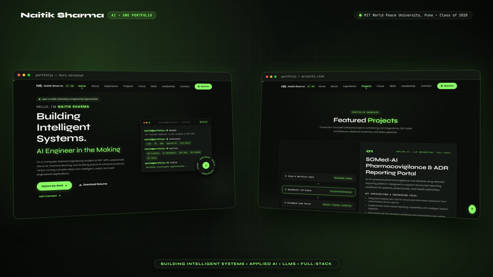
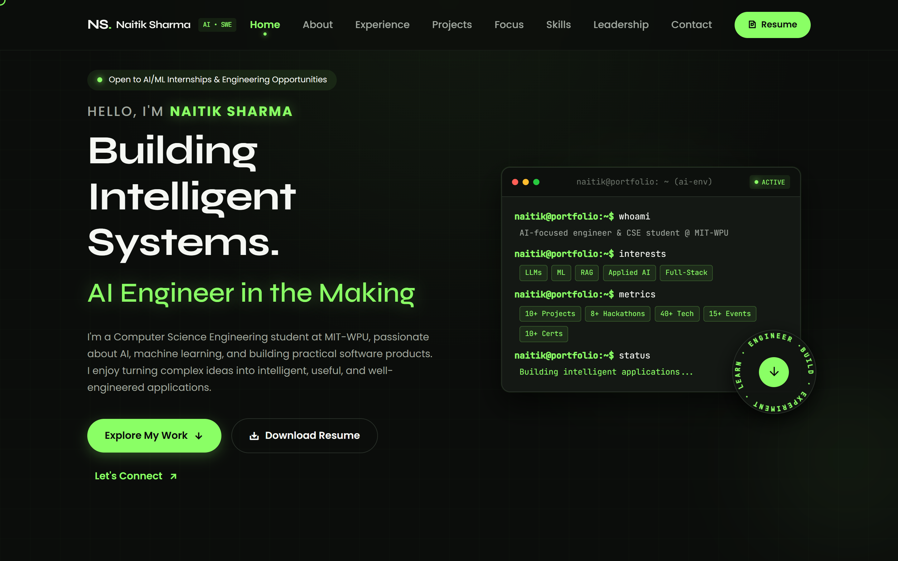
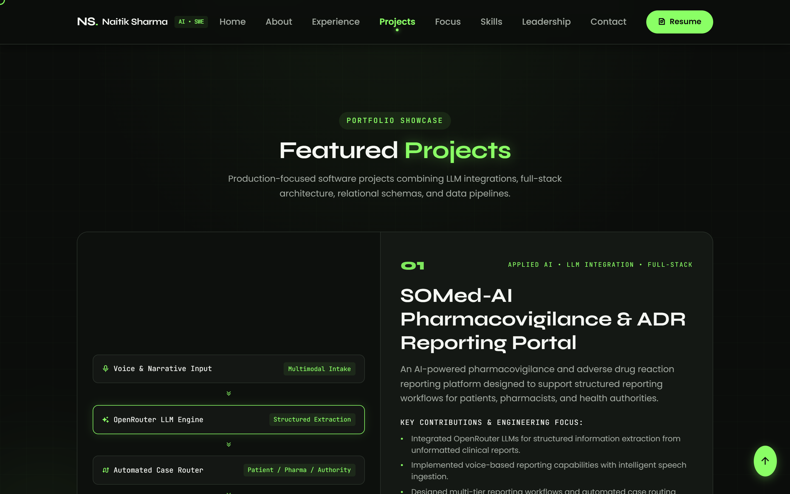
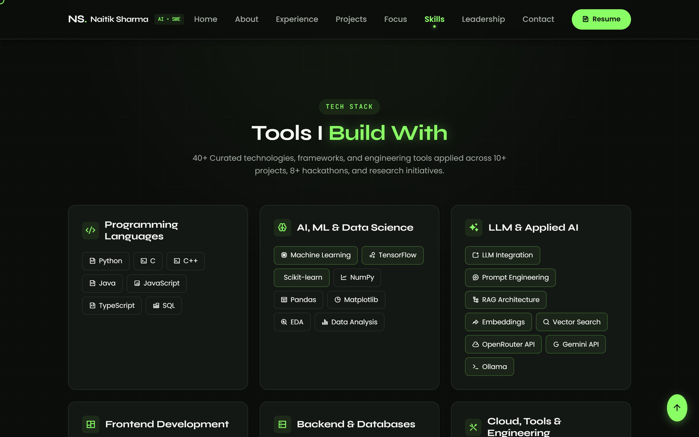

# Naitik Sharma — AI Engineering & Software Development Portfolio

A personal portfolio website for **Naitik Sharma**, Computer Science and Engineering student at **MIT World Peace University, Pune** (Graduation: July 2028 | CGPA: 9.1/10), targeting AI Engineering, Machine Learning Engineering, Applied AI, LLM Engineering, and Full-Stack Software Engineering roles.

Built by transforming the creative, dark-and-lime **Bianca** portfolio design system into a recruiter-ready technical portfolio with terminal cards, interactive architecture diagrams, circular rotating text badges, and responsive layouts.

---

## 🚀 Live Preview & Demo



- **Live Website:** [https://naitiksharma-portfolio.vercel.app/](https://naitiksharma-portfolio.vercel.app/)
- **Local Development Server:** `http://localhost:5500`
- **Verified GitHub Profile:** [https://github.com/NaitikSharma7804](https://github.com/NaitikSharma7804)
- **Verified Live Projects:**
  - **SOMed-AI Portal:** [https://somed-ai-portal-ns-d7c2.vercel.app/](https://somed-ai-portal-ns-d7c2.vercel.app/)
  - **EcoRevive GitHub:** [https://github.com/NaitikSharma7804/EcoRevive](https://github.com/NaitikSharma7804/EcoRevive)
  - **Smart EV Charging Hub GitHub:** [https://github.com/NaitikSharma7804/SMART-EV-CHARGING-MANAGEMENT-SYSTEM](https://github.com/NaitikSharma7804/SMART-EV-CHARGING-MANAGEMENT-SYSTEM)

### 📸 Section Showcase

| Interactive Terminal Hero | Featured Projects & Pipeline | Tech Stack & Skills Grid |
| :---: | :---: | :---: |
|  |  |  |

---

## 🎨 Visual Identity & Design System

- **Color Palette:**
  - Background: `#0B0D0B` (Near-black)
  - Secondary Background: `#111411`
  - Card Surfaces: `#141814` / `#151915`
  - Accent Lime Green: `#8AFF65` (Signature Bianca green)
  - Primary Text: `#F5F7F3`
  - Secondary Text: `#A0A79F`
  - Borders: `#293029`
- **Typography:**
  - Headings: `Syne` (500, 600, 700, 800)
  - Body: `Poppins` (300, 400, 500, 600)
  - Code/Terminal: `JetBrains Mono`
- **Key Visual Elements:**
  - Hero interactive terminal window with live status indicators and syntax styling.
  - Signature Bianca circular rotating text badge (`BUILD · EXPERIMENT · LEARN · ENGINEER ·`).
  - Typed.js dynamic role transitions (`AI Engineer in the Making`, `Machine Learning Enthusiast`, `LLM Application Developer`, `Full-Stack Engineer`).
  - Custom SVG/CSS architecture diagram for SOMed-AI pipeline.
  - Production screenshots from actual repositories.

---

## 📂 Project Structure

```
Portfolio/
├── index.html                 # Semantic, accessible HTML5 structure with SEO tags
├── assets/
│   ├── css/
│   │   └── styles.css         # Complete responsive design system and animations
│   ├── js/
│   │   ├── portfolio-data.js  # Centralized configuration for all links & projects
│   │   └── main.js            # Menu drawer, Typed.js, circular badge & observers
│   ├── img/
│   │   ├── project-ev-charging.png  # Verified EV Charging UI screenshot
│   │   ├── ecorevive-logo.png       # Verified EcoRevive project asset
│   │   └── ...                      # UI icons and graphics
│   ├── Naitik_Sharma_Resume.pdf     # Actual LaTeX resume PDF (downloadable)
│   └── resume.pdf                   # Alias for direct /assets/resume.pdf links
├── robots.txt                 # Search engine crawler configuration
└── README.md                  # Project documentation
```

---

## 🛠️ How to Run Locally

### Option 1: Python (Built-in)
```bash
python -m http.server 5500
```
Open [http://localhost:5500](http://localhost:5500) in your browser.

### Option 2: Node.js (npx serve)
```bash
npx -y serve . -p 5500
```

### Option 3: VS Code Live Server
Right-click `index.html` and select **"Open with Live Server"**.

---

## ⚙️ Configuration & Customization

All personal details, URLs, and project links are centrally defined in:
📁 `assets/js/portfolio-data.js`

To update any link (e.g., when adding a new live demo or updating LinkedIn):
1. Open `assets/js/portfolio-data.js`.
2. Edit the corresponding value in `PORTFOLIO_CONFIG.personal` or `PORTFOLIO_CONFIG.projects`.
3. To update your resume PDF, simply replace `assets/Naitik_Sharma_Resume.pdf`.

---

## 🛡️ Recruiter-Ready Integrity & Honesty

- **Authentic Student Status:** Accurately reflects B.Tech CSE student at MIT-WPU Pune (Expected graduation: July 2028 | CGPA: 9.1/10).
- **No Fabricated Metrics:** No fake benchmarks, user counts, or inflated ratings.
- **Real Engineering Projects:** Verified repositories and working prototypes.
- **Zero Dead Links:** All buttons, navigation anchors, and CTAs route to verified endpoints.

---

Designed & engineered by **Naitik Sharma**.
